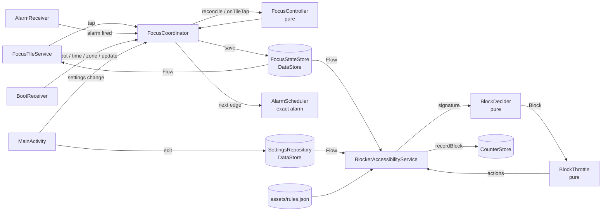
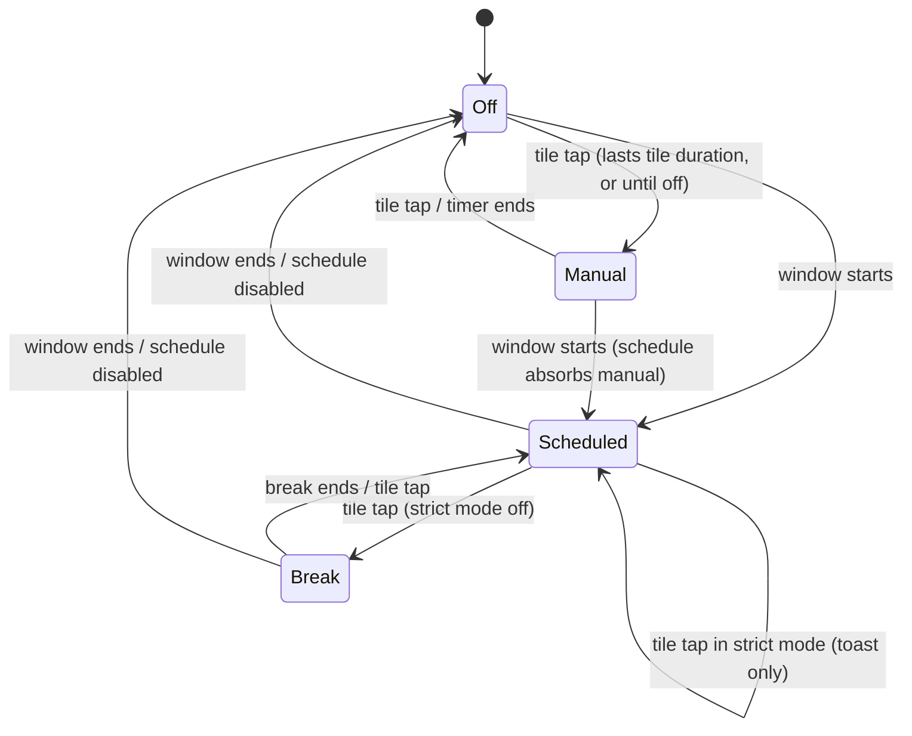

# Inbox Only — technical overview

This is the developer deep dive: how the app works, how it's put together, and how to build, test and
extend it. The [README](../README.md) is the non-technical version. For background on individual
choices, see [DECISIONS.md](DECISIONS.md).

## 1. How it works

```
accessibility event → ScreenSignature → BlockDecider → BlockThrottle → block screen → action (redirect / launch / back / home)
```

1. **Event.** `BlockerAccessibilityService` gets `TYPE_WINDOW_STATE_CHANGED` (a new screen) and
   `TYPE_WINDOW_CONTENT_CHANGED` (something inside it changed). The events come only from the four target
   packages, and only while Focus is on. Window-state events are handled immediately; content-changed
   events are throttled to one check per 250 ms.
2. **Signature.** `ScreenSignatureReader` visits the window's nodes once (capped at 2,000) and keeps
   only the view IDs and content descriptions that `rules.json` mentions for that app. It records which
   are present and which are *selected* (e.g. the active tab). No text is kept. The one exception is an
   optional in-memory hash used to tell Reels apart. A walk is needed because Compose screens expose
   bare tags (`home_screen_surface`) that the framework's ID lookup can't resolve (ADR-016).
3. **Decision.** The pure `BlockDecider.decide(signature, rules, settings, tracker)` returns `Allow` or
   `Block(surfaceId, actions)`:
   1. No rules for the package, or placeholder rules → Allow.
   2. A `followOn` page shows a different item than its visit's first (another YouTube video) →
      `FollowOnTracker` blocks it. The one exception to "allowed screens win" (ADR-021).
   3. Any `allowed` screen matches (DM inbox, chat thread, Reddit thread…) → Allow.
   4. The Reel viewer matches → `ReelFromChatTracker` decides (allow one Reel opened from a chat).
   5. The first matching `surface` → Block if the user has it on, else Allow.
   6. Nothing matched → Allow (**fail open**).

   Both trackers live in a per-app `AppSession`, in memory only.
4. **Throttle.** `BlockThrottle` enforces a 700 ms per-app cooldown. Within the cooldown it asks for a
   recheck when the cooldown ends. If the *same* surface reappears within 2 s of an action, it escalates
   to the next action (`redirect → back → home`). Home is always appended as the last resort.
5. **Block screen.** A fresh block opens `BlockScreenActivity`: our own page, in its own task and hidden
   from Recents, that fades in over the app. `BlockScreenFormatter` turns the rule's first action into
   its main button (the action's `label`, "Go back", or "Close ‹app›"), plus "Close ‹app›". Redirect,
   launch and close are plain intents from the activity. Back must reach the app *underneath*, so the
   activity hands it to the service through `BlockScreenBridge`, which presses Back 450 ms later, after
   the page has faded out. The system Back gesture on the page closes the app (ADR-019).
6. **Action.** If the same surface is back within 2 s of the screen (or of an action), the throttle
   escalates and the service performs the actions directly, without the page: a deep link
   (`redirect`), another app's launcher intent (`launch`), or `GLOBAL_ACTION_BACK` /
   `GLOBAL_ACTION_HOME`. One block event increments the daily counter once.

Focus itself is a separate loop: the **tile**, **alarms** and **settings** all go through
`FocusCoordinator`. It loads the stored `FocusState`, asks the pure `FocusController` for the
transition, saves it, and registers the single next alarm.

### Data flow



### Focus state machine



`FocusState` stores absolute `Instant`s. Every reader passes it through
`FocusController.reconcile(state, settings, now, zone)`, so a late or missed alarm can never leave Focus
in a stale state. One invariant keeps the logic simple: *inside a schedule window the state is always
Scheduled or Break.*

## 2. Layers and package map

All code lives in `app/src/main/java/com/prestoza/inboxonly/`:

| Package | Role | Android imports? |
|---|---|---|
| `domain/` | All decisions: `FocusState`, `FocusController`, `ScheduleCalculator`, `BlockDecider`, `ReelFromChatTracker`, `BlockThrottle`, `Rules` (+ `RulesValidator`), `Settings`, `BlockCatalog`, `TileStatusFormatter`, `DailyCount` | **No.** Pure Kotlin, fully unit-tested |
| `data/` | Persistence: `SettingsRepository`, `FocusStateStore`, `CounterStore`, `OnboardingStore` (all Preferences DataStore), `TimeSource`; `rules/RulesRepository` loads `assets/rules.json` | DataStore, Context |
| `service/` | Thin Android adapters: `BlockerAccessibilityService`, `ScreenSignatureReader`, `FocusTileService`, `FocusCoordinator`, `AlarmScheduler`, `AlarmReceiver`, `BootReceiver`, `AccessibilityStatus`, `PermissionStatus` | Yes |
| `ui/` | Compose: `MainActivity`, `SettingsScreen`, `OnboardingScreen`, `theme/` | Yes |
| root | `InboxOnlyApp` (Application), `AppContainer` (manual DI) | Yes |
| `src/debug/…/debug/` | `InspectorLogger`, `InspectorFormat` (real inspector) | Yes |
| `src/release/…/debug/` | `InspectorLogger` no-op twin | Yes |

Principles:
- **Separation of concerns.** Android components are thin adapters; every decision is in `domain/`.
- **Data-driven selectors.** Every per-app identifier lives in `assets/rules.json`, never in Kotlin.
- **Single source of truth.** `FocusStateStore`, observed as a `Flow` by the tile, UI and service.
- **Fail open.** Unknown screens, broken rules or placeholder rules → allow. Messaging is never blocked by accident.
- **Efficiency.** OS-level package filter, two event types, throttling, targeted lookups, and an inert service when Focus is off.

## 3. `rules.json`

`app/src/main/assets/rules.json` is parsed by kotlinx.serialization into `domain/Rules.kt`. Unknown
fields are ignored, so newer files still load in older builds.

```jsonc
{
  "version": 1,                 // bump on every change
  "placeholder": false,         // true = block nothing (used until real selectors are captured)
  "apps": [{
    "appId": "instagram",       // must match BlockCatalog (links to the user's toggles)
    "package": "com.instagram.android",
    "allowed": [                // always allowed; checked first
      { "id": "dm_thread", "match": { "allViewIds": ["com.instagram.android:id/…"] } }
    ],
    "reelViewer": {             // optional: "allow one Reel opened from a chat"
      "match": { … },
      "surfaceId": "reels_tab", // which toggle governs Reels
      "openedFrom": ["dm_thread"],
      "openedFromWindowClasses": [], // optional: windows that only open from a chat in another app
      "identityViewId": "…",    // optional: node whose label differs per Reel (hashed in memory)
      "identityDescriptionPattern": "…", // optional: same, as a regex over content descriptions
      "actions": [{ "type": "back" }]
    },
    "followOn": {               // optional: "one item per visit" on an allowed page (YouTube's watch page)
      "match": { … },
      "surfaceId": "next_videos",
      "identityViewId": "…",    // label that differs per item, seen while it loads (hashed in memory)
      "resetWindowClasses": ["…"], // windows whose opening starts a new visit (a link opening the app)
      "actions": [{ "type": "home" }]
    },
    "surfaces": [               // blockable; first match wins
      {
        "id": "home_feed",      // must be a BlockCatalog surface id
        "match": { "selectedViewIds": ["…"] },
        "actions": [
          { "type": "redirect", "uri": "…", "package": "com.instagram.android", "label": "Open DMs" },
          { "type": "launch", "package": "com.facebook.orca" },
          { "type": "back" },
          { "type": "home" }
        ]
      }
    ]
  }]
}
```

**`match`**: every *non-empty* condition must hold. A match with no conditions never matches.

| Field | Meaning |
|---|---|
| `windowClasses` | the last window-state event's class is one of these |
| `allViewIds` | all of these view IDs are on screen |
| `anyViewIds` | at least one is on screen |
| `noneViewIds` | none of these are on screen |
| `selectedViewIds` | all of these are on screen *and selected* (e.g. the active tab) |
| `noneSelectedViewIds` | none of these is selected (e.g. Instagram right after launch, before any tab is tapped) |
| `contentDescriptions` | at least one node has exactly this content description |
| `selectedContentDescriptions` | all of these are on a selected node |

Copy view IDs exactly as the inspector prints them: classic views are fully qualified
(`com.instagram.android:id/feed_tab`), Compose tags are bare (`home_screen_surface`). Facebook obfuscates
its view IDs, so its rules use tab content descriptions such as `"Home, tab 1 of 5"`. Those are
English-UI strings and can change when a badge is added.
`RulesValidator` (run by `RulesTest` against the shipped file) rejects unknown app or surface IDs, empty
matches, empty action lists, dangling `openedFrom` references and Reel viewers with no way to be
opened from a chat.

## 4. Scheduling and alarms

- **One alarm at a time.** `FocusController.nextAlarm` picks the earliest future edge: manual timer end,
  break end, window end or next window start. `AlarmScheduler` registers it with
  `setExactAndAllowWhileIdle(RTC_WAKEUP, …)`.
- **Permission:** `USE_EXACT_ALARM` on Android 13+ (auto-granted, not revocable; Play restricts it, but
  this app is sideloaded), and `SCHEDULE_EXACT_ALARM` with `maxSdkVersion=32` for Android 12/12L.
  Android 10/11 need nothing.
- **Re-registration:** `BootReceiver` handles `BOOT_COMPLETED`, `TIME_SET`, `TIMEZONE_CHANGED`,
  `MY_PACKAGE_REPLACED` and the exact-alarm permission change. Every process start also calls
  `refresh()`, which repairs alarms lost to a force-stop.
- **Windows:** `ScheduleCalculator` uses `java.time`. The selected days are *start* days, so a window
  can run past midnight. A start time that falls in a DST gap moves forward by the gap; a start time
  that falls in a DST overlap uses the first occurrence. Start == end means no window.
- **Late alarms** don't matter for correctness: `reconcile()` runs on every read.

## 5. Permissions and why

| Permission / component | Why |
|---|---|
| Accessibility service (`BIND_ACCESSIBILITY_SERVICE`) | See which screen the four apps show; press Back/Home |
| `USE_EXACT_ALARM` / `SCHEDULE_EXACT_ALARM` (≤ API 32) | Timer, break and schedule edges on time, even in Doze |
| `RECEIVE_BOOT_COMPLETED` | Re-register the alarm after a reboot |
| `REQUEST_IGNORE_BATTERY_OPTIMIZATIONS` | Show the system's "stop optimizing?" dialog in onboarding |
| `<queries>` for 5 packages | Android 11+ package visibility, to open Messenger or a deep link |
| **No `INTERNET`** | Explicitly removed (`tools:node="remove"`); CI fails if any APK requests it |

## 6. Battery

- **OS-level filtering.** The service XML declares `packageNames` for the four apps only, so the system
  never delivers events from anything else.
- **Inert when Focus is off.** On every Focus change the service calls `setServiceInfo()` with
  `eventTypes = 0` (off) or the two types (on). `packageNames` is never cleared: null would mean *all
  apps*.
- **Minimal work per event.** Two event types; content changes throttled to 250 ms (at most 4 checks a
  second); one bounded pass over the window per check, comparing only against rule-referenced IDs;
  nodes recycled on Android < 13.
- **No polling, wakelocks, foreground service or background workers.** Alarms fire only at edges.
- **Free countdown.** The tile subtitle is computed in `onStartListening()`, which only runs while the
  shade is open. There's no ticking timer.
- **No network, no analytics, no logging in release builds.** The inspector's release twin is a no-op.
- In debug builds only, the service also listens while Focus is off so the inspector can capture screens.

## 7. Build from source (macOS, command line, no Android Studio needed)

Versions: **AGP 9.5**, **Gradle 9.8** (wrapper), **Kotlin 2.4**, **compileSdk/targetSdk 37**
(Android 17), **minSdk 29** (Android 10), **JDK 17+** (CI uses 17; any newer JDK works locally).

```bash
# JDK 17 or newer
brew install --cask temurin@17            # or any JDK ≥ 17 you already have

# Android command-line tools + SDK packages
brew install --cask android-commandlinetools
export ANDROID_HOME=/opt/homebrew/share/android-commandlinetools   # add to ~/.zshrc
export PATH="$ANDROID_HOME/platform-tools:$PATH"
sdkmanager --licenses
sdkmanager "platform-tools" "platforms;android-37.0" "build-tools;37.0.0"

# Build and install
./gradlew assembleDebug
adb install -r app/build/outputs/apk/debug/app-debug.apk
```

Instead of exporting `ANDROID_HOME`, you can put `sdk.dir=/path/to/sdk` in `local.properties`
(gitignored). Useful tasks: `spotlessApply` (format), `spotlessCheck`, `testDebugUnitTest`,
`lintDebug lintRelease`, `assembleRelease`, and `scripts/check-no-internet.sh` after assembling.

## 8. Release signing

`app/build.gradle.kts` signs release builds only when these environment variables are set:
`SIGNING_KEYSTORE_PATH`, `SIGNING_KEYSTORE_PASSWORD`, `SIGNING_KEY_ALIAS`, `SIGNING_KEY_PASSWORD`.
Without them, `assembleRelease` makes an unsigned APK. **Never commit a keystore** (`*.jks` is gitignored).

One-time setup:

```bash
keytool -genkeypair -keystore inbox-only-release.jks -alias inboxonly \
  -keyalg RSA -keysize 4096 -validity 10000
base64 -i inbox-only-release.jks | pbcopy   # copies the keystore as text
```

In GitHub → repo **Settings → Secrets and variables → Actions**, add:

| Secret | Value |
|---|---|
| `SIGNING_KEYSTORE_BASE64` | the base64 text you just copied |
| `SIGNING_KEYSTORE_PASSWORD` | keystore password |
| `SIGNING_KEY_ALIAS` | `inboxonly` (or your alias) |
| `SIGNING_KEY_PASSWORD` | key password |

Keep the `.jks` file and passwords somewhere safe (e.g. a password manager). Android only accepts an
update signed with the **same key**, so if you lose it, you'll have to uninstall the app before
installing a newer version.

Pushing a tag `v*` (e.g. `git tag v1.0.0 && git push origin v1.0.0`) runs `.github/workflows/release.yml`.
It tests, builds and verifies the signed APK, checks there's no INTERNET permission, and publishes a
GitHub Release with `inbox-only-v1.0.0.apk` attached.

## 9. CI

`.github/workflows/ci.yml` runs on every push and PR: `spotlessCheck`, `testDebugUnitTest`,
`lintDebug lintRelease` (warnings are errors), `assembleDebug assembleRelease`, and
`scripts/check-no-internet.sh`.

## 10. Project layout

```
app/
  build.gradle.kts
  src/main/AndroidManifest.xml
  src/main/assets/rules.json                  # all per-app selectors
  src/main/res/xml/accessibility_service_config.xml
  src/main/java/com/prestoza/inboxonly/{domain,data,service,ui}/
  src/debug/…/debug/                          # inspector (debug only)
  src/release/…/debug/                        # inspector no-op
  src/test/…                                  # JVM unit tests
  src/testDebug/…                             # tests for debug-only code
docs/  scripts/  .github/workflows/
gradle/libs.versions.toml                     # version catalog
```

## 11. Testing strategy

- **Domain unit tests** (JUnit 4, kotlinx-coroutines-test) cover:
  - `ScheduleCalculator`: midnight crossing, DST gap and overlap in America/Los_Angeles, time zone change, week wrap.
  - `FocusController`: every tap transition, expiry, strict mode, breaks, reboot mid-break, missed alarms.
  - `BlockDecider`: every surface in the spec table, allowed screens, fail open, toggles.
  - `ReelFromChatTracker`, `BlockThrottle` and `TileStatusFormatter`.
- **Data tests** reopen real DataStore files to prove state survives process death.
- **`FocusCoordinatorTest`** runs whole flows against real DataStores with a fake clock and a fake alarm scheduler.
- **Config guards:**
  - The service XML package filter equals the packages in rules.json.
  - The shipped rules.json parses and validates.
- **Fixtures:** `FixtureScreens.kt` holds real screen signatures captured on the owner's phone, reduced to
  what the rules reference, and `BlockDeciderTest` runs the *shipped* `rules.json` against them.
- **On-device acceptance:** [TESTING.md](TESTING.md).

## 12. How to add a new app or surface

1. **Catalog.** Add the app (or surface) to `domain/BlockCatalog.kt` with a stable ID and a label. This
   is what the settings screen lists and what `rules.json` refers to.
2. **Capture.** Install a debug build, add the package to the service filter (step 3), run
   `scripts/inspect.sh`, and open each screen of the new app. See [UPDATING_RULES.md](UPDATING_RULES.md).
3. **Service filter.** Add the package to `android:packageNames` in
   `res/xml/accessibility_service_config.xml`, and to `<queries>` in the manifest if you'll launch it.
4. **Rules.** Add an `apps` entry to `assets/rules.json`: `allowed` screens first (always include the
   app's messaging screens), then `surfaces` with actions. Bump `version`.
5. **Tests.** Add the captured signatures for the new screens to `FixtureScreens.kt`, and cases to
   `BlockDeciderTest`. `ServiceConfigTest` and `RulesTest` will catch
   a mismatched package or invalid rule.
6. **Docs.** Update the README table and `CHANGELOG.md`.
